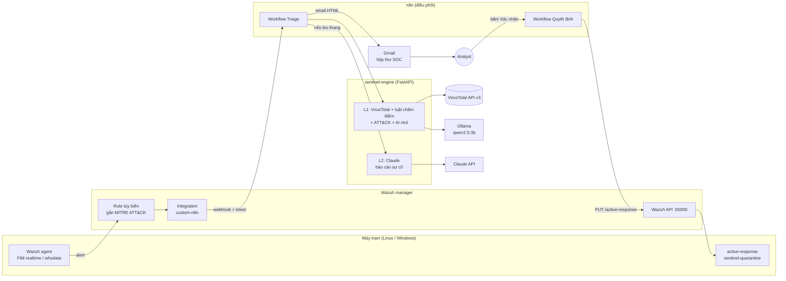

# Sentinel-FIM

**Tự động đánh giá tấn công từ cảnh báo toàn vẹn file (FIM) bằng Wazuh, n8n, VirusTotal, mô hình AI nhỏ và Claude — có ánh xạ MITRE ATT&CK và cảnh báo qua Gmail.**

> Đồ án môn học / đồ án chuyên ngành An toàn thông tin. Mục tiêu: mô phỏng một quy trình SOC
> thu nhỏ — phát hiện → làm giàu thông tin → phân loại → phân tích → báo cáo → con người ra quyết định —
> chạy được trên lab vài máy ảo, chi phí gần như bằng 0.

## Bài toán

Wazuh FIM sinh rất nhiều alert kiểu *"File added to the system"*. Một alert như vậy **không nói được**:

- file đó có phải **mã độc đã được báo cáo** không? (→ VirusTotal, tra cứu theo hash)
- nó nằm ở vị trí/ngữ cảnh nguy hiểm đến mức nào? (→ luật chấm điểm + **MITRE ATT&CK**)
- analyst nên làm gì ngay bây giờ? (→ **AI nhỏ** phân loại sơ bộ, **Claude** viết báo cáo sự cố)
- và ai quyết định cách ly? (→ **email Gmail** có nút duyệt, n8n gọi **Wazuh Active Response**)

## Kiến trúc



| Thành phần | Vai trò trong hệ thống | Tương ứng ngoài thực tế |
|---|---|---|
| **Wazuh** | Giám sát toàn vẹn file (FIM), rule tùy biến gắn ATT&CK, chạy active response | SIEM/XDR (Splunk, QRadar, Elastic, Microsoft Defender) |
| **n8n** | Điều phối luồng xử lý, gửi email, gọi Wazuh API | SOAR (Splunk SOAR, Cortex XSOAR, Shuffle, Tines) |
| **VirusTotal** | Trả lời *"virus này đã được báo cáo chưa?"* theo hash — không bao giờ upload file | Threat Intelligence / reputation feed |
| **Mô hình AI nhỏ** (Ollama, chạy cục bộ) | Phân loại sơ bộ mọi alert, dữ liệu không rời hệ thống, 0đ/alert | SOC analyst cấp 1 (L1) |
| **Claude** | Chỉ phân tích sự cố được leo thang: tóm tắt, đánh giá dương tính giả, ATT&CK, IOC, các bước xử lý | SOC analyst cấp 2 (L2) / incident responder |
| **Gmail** | Gửi báo cáo + nút *Cách ly* / *Dương tính giả* | Kênh cảnh báo, ticket, on-call |
| **Analyst** | Quyết định cuối cùng (human-in-the-loop) | SOC L3 / IR lead |

Chi tiết: [docs/01-kien-truc.md](docs/01-kien-truc.md).

## Nguyên tắc thiết kế quan trọng

1. **Luật quyết định, AI chỉ được nâng mức.** Điểm rủi ro tính bằng luật tường minh (giải thích được từng điểm).
   Mô hình AI chỉ có thể *nâng* mức hoặc leo thang, không bao giờ *hạ* mức — vì tên file do kẻ tấn công đặt
   có thể chứa prompt injection (`IGNORE ALL PREVIOUS INSTRUCTIONS ... .pdf.exe`, có trong `samples/`).
2. **Phân tầng chi phí:** VirusTotal + luật + AI nhỏ cho *mọi* alert; Claude chỉ cho alert đáng ngờ.
3. **Không upload file lên VirusTotal**, chỉ tra hash; ẩn tên người dùng/IP trước khi gửi cho Claude.
4. **Con người duyệt hành động.** Link trong email chỉ mở trang xác nhận (bộ lọc thư tự "bấm thử" link sẽ không
   gây cách ly); token HMAC có hạn dùng, dùng một lần; script trên agent xác minh lại SHA256 trước khi cách ly,
   và **cách ly chứ không xoá** để giữ bằng chứng.

## Cấu trúc thư mục

```
engine/                 Dịch vụ phân tích (Python/FastAPI) + unit test (pytest)
  sentinel/normalize.py   chuẩn hoá alert Wazuh
  sentinel/virustotal.py  VirusTotal API v3: cache SQLite, giới hạn 4 req/phút, 500 req/ngày
  sentinel/scoring.py     chấm điểm rủi ro có giải thích
  sentinel/mitre.py       ánh xạ MITRE ATT&CK (rule Wazuh, sandbox VT, heuristic)
  sentinel/small_llm.py   phân loại L1 bằng mô hình nhỏ qua Ollama
  sentinel/claude.py      báo cáo L2 bằng Claude (structured output)
  sentinel/report.py      email HTML (escape chống HTML injection)
  sentinel/pipeline.py    điều phối, chống trùng, allowlist dương tính giả
n8n/workflows/          2 workflow import được vào n8n
wazuh/                  rule tùy biến, cấu hình FIM, integration, active response
samples/alerts/         6 alert mẫu (EICAR, WannaCry, web shell, SSH key, PDF sạch, prompt injection)
scripts/                phát lại alert, mô phỏng kỹ thuật tấn công vô hại trên máy lab
docs/                   kiến trúc, triển khai, kịch bản đánh giá, ánh xạ thực tiễn, gợi ý báo cáo
```

## Chạy nhanh

```bash
# 1. Engine + n8n + Ollama
cp .env.example .env            # điền VT_API_KEY, ANTHROPIC_API_KEY, token...
docker compose up -d --build
docker compose --profile setup run --rm ollama-pull

# 2. Thử engine với alert mẫu (không cần Wazuh)
python3 scripts/replay_alerts.py --engine http://127.0.0.1:8000 --token "$SENTINEL_API_TOKEN" --analyze

# 3. Chạy test
cd engine && pip install -r requirements.txt pytest && pytest -q
```

Kết quả mong đợi với 6 alert mẫu (VirusTotal được giả lập trong test):

| Alert mẫu | VirusTotal | Điểm | Mức | ATT&CK |
|---|---|---|---|---|
| EICAR tải về Downloads bằng `wget` | 62/71 · `virus.eicar/test` | 80 | critical | T1204.002, T1105 |
| WannaCry trong thư mục Startup, ghi bởi PowerShell | 68/72 · `ransomware.wannacry/wanna` | 100 | critical | T1547.001, T1059.001 |
| Web shell PHP **chưa từng được báo cáo** | not found | 55 | high | T1505.003 |
| Khoá lạ thêm vào `/root/.ssh/authorized_keys` | — | 35 | medium (AI nhỏ có thể leo thang) | T1098.004 |
| File PDF sạch | 0/60 | 0 | low (không gửi email) | — |
| `...IGNORE ALL PREVIOUS INSTRUCTIONS... .pdf.exe` | not found | 40 | medium (AI không hạ được) | T1036.007, T1204.002 |

Hướng dẫn đầy đủ: [docs/02-trien-khai.md](docs/02-trien-khai.md) ·
Kịch bản đánh giá: [docs/03-kich-ban-danh-gia.md](docs/03-kich-ban-danh-gia.md) ·
Ánh xạ thực tiễn: [docs/04-anh-xa-thuc-tien.md](docs/04-anh-xa-thuc-tien.md) ·
Gợi ý báo cáo đồ án: [docs/05-goi-y-bao-cao.md](docs/05-goi-y-bao-cao.md)

## Lưu ý

- Chỉ chạy `scripts/simulate_linux_lab.sh` trên máy ảo lab. Dự án không cần và không dùng mẫu mã độc thật:
  "virus đã được báo cáo" được kiểm chứng bằng hash (EICAR, WannaCry) và file kiểm thử EICAR.
- API công khai (free) của VirusTotal chỉ dành cho mục đích phi thương mại.
