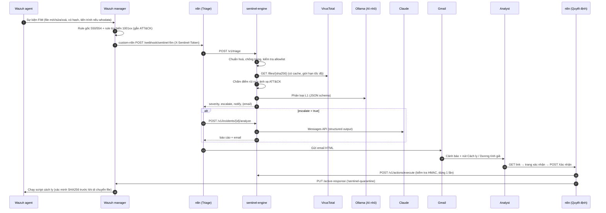

# 1. Kiến trúc và luồng xử lý

## 1.1. Luồng một alert đi qua hệ thống



## 1.2. Mô hình phân tầng SOC

| Tầng | Ở Sentinel-FIM | Xử lý | Chi phí | Dữ liệu rời hệ thống? |
|---|---|---|---|---|
| Thu thập | Wazuh FIM | 100% sự kiện trong thư mục giám sát | 0 | Không |
| Làm giàu | VirusTotal | mọi file có hash (có cache) | Free: 4 req/phút | Chỉ hash |
| L1 | Luật chấm điểm + mô hình nhỏ (Ollama) | mọi alert | 0 (CPU cục bộ) | Không |
| L2 | Claude | chỉ alert được leo thang | ~vài cent/sự cố (đo trong phần đánh giá) | Có, đã ẩn danh một phần |
| L3 | Analyst | đọc email, duyệt hành động | thời gian con người | — |

Ý tưởng cốt lõi: **càng lên tầng trên càng đắt và chậm, nên mỗi tầng phải lọc bớt cho tầng sau** — đúng
như cách một SOC thật tổ chức nhân sự L1/L2/L3.

## 1.3. Chấm điểm rủi ro (`engine/sentinel/scoring.py`)

Điểm 0–100 là tổng các yếu tố, mỗi yếu tố có mô tả tiếng Việt và được in ra trong email để analyst
biết *vì sao* hệ thống kết luận như vậy.

| Nhóm | Yếu tố | Điểm |
|---|---|---|
| Danh tiếng (VirusTotal) | ≥ 10 engine phát hiện | +50 |
| | 3–9 engine | +35 |
| | 1–2 engine (có thể là dương tính giả) | +15 |
| | chỉ có engine "suspicious" | +10 |
| | đã có nhãn mối đe doạ (`suggested_threat_label`) | +5 |
| | file đã biết và sạch (0 engine) | −10 |
| | hash **chưa từng xuất hiện** + file thực thi | +10 |
| Ngữ cảnh máy trạm | file thực thi / script | +10 |
| | vị trí persistence hoặc leo thang đặc quyền (Startup, Run key, cron, systemd, authorized_keys, sudoers, web root…) | +20 |
| | hai phần mở rộng (`.pdf.exe`) | +15 |
| | dấu hiệu ransomware: phần mở rộng đặc trưng, hoặc rule "nhiều file bị sửa trong 60 giây" | +40 |
| | thư mục tạm / Downloads | +5 |
| | ghi bởi LOLBin (powershell, certutil, mshta, wget, curl…) — cần whodata | +10 |
| Rule Wazuh | level ≥ 12 / ≥ 10 / ≥ 7 | +15 / +10 / +5 |
| Phản hồi analyst | hash nằm trong allowlist (đã đánh dấu dương tính giả) | điểm = 0 |

Ngưỡng mức độ: `low` < 25 ≤ `medium` < 50 ≤ `high` < 75 ≤ `critical`.

Yếu tố ngữ cảnh chỉ xét kỹ thuật ATT&CK suy ra từ *chính sự kiện* (vị trí, tiến trình, rule Wazuh). Kỹ thuật
quan sát trong sandbox VirusTotal mô tả hành vi của mẫu khi chạy, đã được tính qua điểm danh tiếng, nên không
cộng thêm lần nữa (tránh tính trùng).

Hai nhóm yếu tố bổ sung cho nhau:
- **VirusTotal** bắt mã độc *đã được báo cáo* (đúng yêu cầu đề tài) nhưng mù với mẫu mới/biến thể (mỗi biến thể đa hình có hash khác).
- **Ngữ cảnh** (vị trí, tiến trình, rule) bắt được cả mẫu *chưa ai báo cáo* — ví dụ web shell trong `samples/alerts/03_*` không có trên VirusTotal nhưng vẫn ra mức `high`.

## 1.4. Quy tắc leo thang

```
llm_flag  = (severity ≥ medium  và AI nhỏ nói suspicious/malicious với độ tin cậy ≥ 0.6)
         hoặc (AI nhỏ nói malicious với độ tin cậy ≥ 0.8)
notify    = severity ≥ NOTIFY_MIN_SEVERITY (mặc định medium)  hoặc llm_flag
escalate  = Claude được bật  và (severity ≥ ESCALATE_MIN_SEVERITY (mặc định high) hoặc llm_flag)
final     = max(severity, mức Claude đề xuất)      ← AI chỉ nâng, không hạ
```

Nếu Claude đánh giá "khả năng dương tính giả: cao", email vẫn giữ mức theo luật và hiển thị nhận định đó để
analyst quyết định (bấm *Đánh dấu dương tính giả* → hash vào allowlist → lần sau điểm = 0).

## 1.5. Ánh xạ MITRE ATT&CK (`engine/sentinel/mitre.py`)

Ba nguồn, gộp và loại trùng:

1. **Rule Wazuh** — `rule.mitre.id` (rule tùy biến trong `wazuh/rules/` đều gắn sẵn).
2. **Sandbox VirusTotal** — `GET /files/{id}/behaviour_mitre_trees`: kỹ thuật quan sát được khi chạy mẫu thật
   (chỉ gọi khi file bị phát hiện độc hại, để tiết kiệm hạn mức).
3. **Heuristic** theo vị trí/tiến trình:

| Dấu hiệu | Kỹ thuật |
|---|---|
| Thư mục Startup, khoá Run/RunOnce | T1547.001 Registry Run Keys / Startup Folder |
| `/etc/cron*`, `/var/spool/cron` | T1053.003 Cron |
| `/etc/systemd/system/*` | T1543.002 Systemd Service |
| `~/.ssh/authorized_keys` | T1098.004 SSH Authorized Keys |
| `/etc/passwd`, `/etc/shadow` | T1136.001 Local Account |
| `/etc/sudoers*` | T1548.003 Sudo and Sudo Caching |
| `/etc/ld.so.preload` | T1574.006 Dynamic Linker Hijacking |
| `.bashrc`, `/etc/profile.d` | T1546.004 Unix Shell Configuration Modification |
| Script mới trong web root | T1505.003 Web Shell |
| Binary hệ thống bị sửa | T1554 Compromise Host Software Binary |
| File thực thi mới trong Downloads | T1204.002 Malicious File |
| File thực thi mới trong thư mục tạm, hoặc ghi bởi certutil/curl/wget | T1105 Ingress Tool Transfer |
| `.pdf.exe`, `.docx.scr`… | T1036.007 Double File Extension |
| `.locked`, `.wncry`… / nhiều file bị sửa trong 60 giây | T1486 Data Encrypted for Impact |
| Ghi bởi powershell / wscript / mshta / rundll32 / bitsadmin | T1059.001 / T1059.005 / T1218.005 / T1218.011 / T1197 |

Claude nhận danh sách gợi ý này và có thể giữ, sửa hoặc bỏ từng kỹ thuật kèm lý do.

## 1.6. Thiết kế an toàn của chính hệ thống

Một hệ thống phòng thủ đọc dữ liệu do kẻ tấn công kiểm soát (tên file, đường dẫn) phải tự bảo vệ:

| Mối đe doạ | Biện pháp | Vị trí trong mã |
|---|---|---|
| Prompt injection qua tên file | Dữ liệu bọc trong thẻ `<alert>`/`<incident>`, system prompt yêu cầu coi là dữ liệu; **AI không thể hạ mức** do luật xác định | `small_llm.py`, `claude.py`, `pipeline.py` |
| HTML injection vào email analyst | `html.escape` mọi giá trị; chỉ tạo link tới URL tự dựng (VirusTotal theo hash hex, ATT&CK theo mã đã kiểm tra regex) | `report.py` |
| Header injection qua tiêu đề email | Loại bỏ ký tự xuống dòng trong subject | `report.py::build_subject` |
| Link hành động bị giả mạo/dùng lại | HMAC-SHA256 gắn `incident|action|expiry`, so sánh hằng thời gian, sự cố chỉ xử lý được một lần | `actions.py`, `store.record_decision` |
| Bộ quét link của Gmail/Outlook tự bấm link | GET chỉ hiện trang xác nhận; hành động cần POST | `api.py`, workflow *Quyết định* |
| Cách ly nhầm file (file bị thay sau khi alert) | Script trên agent tính lại SHA256, khác thì huỷ; không theo symlink | `wazuh/active-response/sentinel-quarantine` |
| Mất bằng chứng | Cách ly (move + chmod 400 + metadata), không xoá | như trên |
| Lộ dữ liệu ra bên ngoài | Chỉ gửi hash cho VirusTotal; ẩn `/home/<user>`, IP, tên máy trước khi gửi Claude (`CLAUDE_REDACT`) | `claude.py` |
| Lộ bí mật qua FIM | Không bật `report_changes` cho `/etc/shadow` (diff sẽ chứa hash mật khẩu) | `wazuh/manager/agent.conf` |
| Gọi trái phép API engine | Token `X-Sentinel-Token` (so sánh hằng thời gian); engine chỉ mở cổng trên localhost | `api.py`, `docker-compose.yml` |
| Cạn hạn mức VirusTotal / bão alert | Cache SQLite (24h cho file đã biết, 2h cho file chưa có), giới hạn 4/phút + 500/ngày, gộp alert trùng 10 phút | `virustotal.py`, `pipeline.py` |

## 1.7. API của engine

| Method | Đường dẫn | Mô tả |
|---|---|---|
| GET | `/healthz` | Trạng thái + thành phần nào đang bật |
| POST | `/v1/triage` | Nhận alert Wazuh (JSON thô) → kết quả L1 |
| POST | `/v1/incidents/{id}/analyze` | Chạy L2 (Claude), dựng email |
| GET | `/v1/incidents`, `/v1/incidents/{id}` | Tra cứu sự cố (phục vụ báo cáo/đánh giá) |
| GET | `/v1/actions/confirm` | Kiểm tra link, trả HTML trang xác nhận |
| POST | `/v1/actions/execute` | Ghi quyết định; với cách ly trả về body cho Wazuh API |

Mọi endpoint trừ `/healthz` yêu cầu header `X-Sentinel-Token`.
